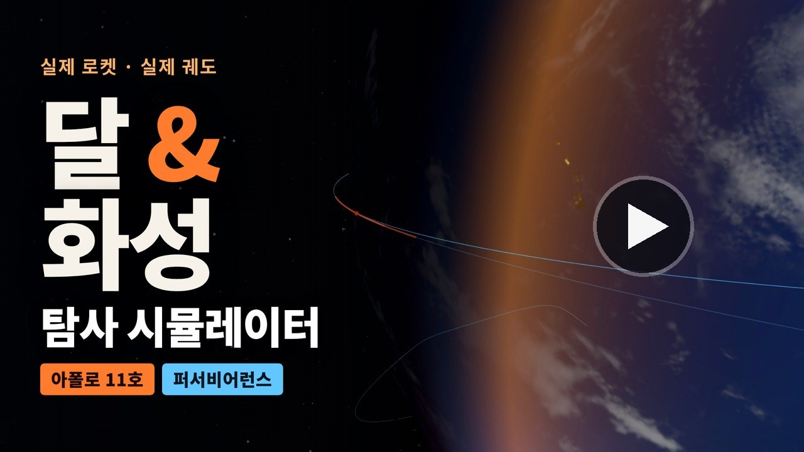
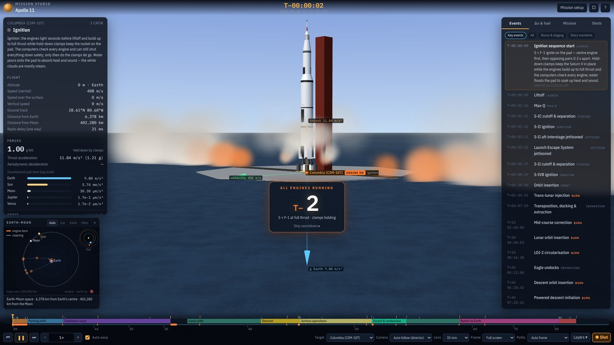
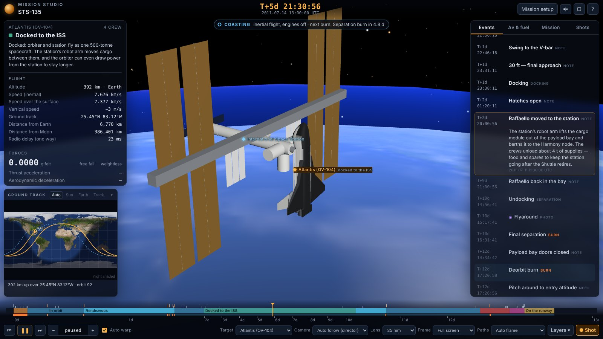
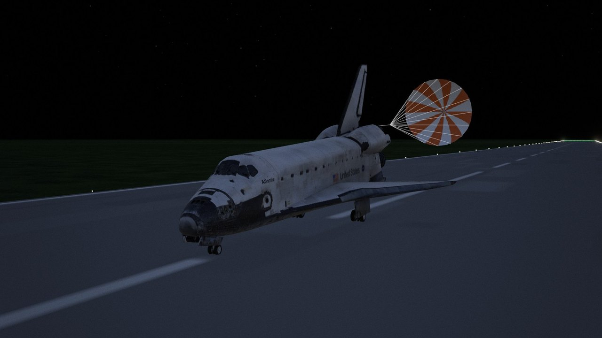

# Mission Studio (임무 스튜디오)

**우주왕복선, 달, 화성 — 실제 우주 임무를 브라우저에서 3D로 재현하는 시뮬레이터입니다.** 임무를 고르면 발사대 카운트다운부터 착륙까지 비행 전체를 볼 수 있어요. 순간마다 화면의 숫자와 설명이 함께 나와요:

- 탑재물, 로켓 크기, 연료
- 중력과 가속도
- 궤도와 스윙바이(중력 도움)

태양계 영화의 스토리보드를 만들려고 만든 도구라서, 카메라·렌즈·장면 저장 기능이 영화 작업에 맞춰져 있어요.

[**▶ 시뮬레이터 열기**](https://sanghyunpark.pages.dev/apps/mission-studio/) · [1분 소개 영상](https://www.youtube.com/watch?v=RXN-PMDKZEs) · [프로젝트 소개](https://sanghyunpark.pages.dev/ko/projects/mission-studio/) · [English README](README.md)

[](https://www.youtube.com/watch?v=RXN-PMDKZEs)

## 할 수 있는 것

- **임무 선택 또는 직접 설정**
  - 실제로 비행했거나 계획된 임무 16개가 준비되어 있어요.
  - 비행을 시작하기 전에 바꿀 수 있는 것:
    - 발사체
    - 발사 날짜와 발사장
    - 주차 궤도
    - 비행 시간
    - 달 궤도 고도
    - 착륙 지점과 표면 체류 기간
    - 승무원 수
    - 우주왕복선: 궤도, 화물칸 탑재물, OMS 연료, 착륙 활주로, 감속 낙하산
- **비행 전체를 재현**
  - 발사대 점화(T−0 전 액체 엔진 점화 → 고정 장치 해제)
  - 상승(새턴 V의 롤 프로그램 포함)과 단 분리, 주차 궤도, 궤도 전이 분사
  - 스윙바이
  - 대기권 진입, 낙하산, 스카이 크레인
  - 착륙과 로버 주행
  - 달 이륙과 랑데부, 귀환
  - 우주왕복선
    - 롤 프로그램, 부스터 분리, 떨어져 나가는 외부 연료 탱크
    - OMS 분사
    - 국제우주정거장 도킹, 또는 로봇 팔로 허블 우주망원경 놓아주기
    - 롤 리버설로 방향을 잡는 활공 재진입
    - 활주로 착륙
- **실시간 수치와 설명**
  - 고도와 속도, 체감 g
  - 추력과 가속도, 남은 연료와 단별 Δv
  - 천체별 중력 세기, 교신 지연
  - 단계마다 쉬운 말로 된 설명
- **엔진 분사와 관성 비행 구분**
  - 엔진을 켠 구간은 굵은 주황 띠, 관성 비행은 가는 파란 선으로 그려요.
  - 3D 경로, 태양계 지도, 타임라인 모두 같은 색을 써요.
- **카메라**
  - 자동 추적(디렉터) 모드, 궤도·추적·바라보기·지상·위에서 보기
  - 12–3200 mm 렌즈와 영화 화면비 가이드(2.39:1 등)
  - 마우스나 손가락으로 돌리고 확대해요.
- **소리**
  - 모든 소리는 브라우저에서 실시간으로 합성해요.
    - 엔진 굉음, 공기 가르는 소리, 대기권 재진입
    - 낙하산, 로버 모터
    - 카운트다운 신호음, 분리, 착지
    - 잔잔한 배경 음악(선택)
  - 스피커 버튼이나 <kbd>M</kbd>으로 켜요.
  - **Silent in vacuum**을 체크하면 실제 우주처럼 대기 밖의 엔진 소리가 들리지 않아요.
- **스토리보드**
  - **Shot** 버튼을 누르면 장면을 저장해요.
  - 장면에는 임무 시각, 카메라, 렌즈, 비행 데이터가 함께 기록돼요.
  - 저장한 장면은 콘택트 시트로 모아 보거나 텍스트로 복사할 수 있어요.



| | |
|---|---|
|  |  |

## 임무 목록

| 임무 | 연도 | 발사체 | 내용 | 상태 |
|---|---|---|---|---|
| STS-1 컬럼비아 | 1981 | 우주왕복선 | 첫 우주왕복선 비행, 로저스 건호(마른 호수) 착륙 | 비행 완료 |
| STS-31 디스커버리 | 1990 | 우주왕복선 | 허블 우주망원경 배치 | 비행 완료 |
| STS-135 아틀란티스 | 2011 | 우주왕복선 | 국제우주정거장 도킹, 마지막 왕복선 비행 | 비행 완료 |
| 아폴로 8호 | 1968 | 새턴 V | 유인 달 궤도 비행 후 귀환 | 비행 완료 |
| 아폴로 11호 | 1969 | 새턴 V | 유인 달 착륙 후 귀환 | 비행 완료 |
| 아폴로 13호 | 1970 | 새턴 V | 자유 귀환 궤도로 비상 귀환 | 비행 완료 |
| 아르테미스 II | 2026 | SLS 블록 1 | 유인 달 근접 비행(자유 귀환) | 비행 완료 |
| 창어 5호 | 2020 | 창정 5호 | 무인 착륙, 시료 채취 후 귀환 | 비행 완료 |
| 매리너 4호 | 1965 | 아틀라스-아제나 D | 화성 근접 비행 | 비행 완료 |
| 마스 2020 퍼서비어런스 | 2020–21 | 아틀라스 V 541 | 화성 진입, 스카이 크레인 착륙, 로버 주행 | 비행 완료 |
| 톈원 1호 / 주룽 | 2020–21 | 창정 5호 | 화성 궤도선 + 착륙 | 비행 완료 |
| 유로파 클리퍼 | 2024 | 팰컨 헤비 | 화성·지구 스윙바이 | 비행 중 |
| 화성 시료 귀환 | 2031 | 창정 5호 | 무인 착륙, 시료 귀환 | 계획/구상 |
| 스타십 유인 화성 착륙 | 2033 | 스타십 | 유인 착륙 후 귀환 | 구상 |
| 스타십 유인 화성 궤도 | 2033 | 스타십 | 유인 궤도 비행 후 귀환 | 구상 |
| 인스피레이션 마스 | 2018 | SLS 블록 1 | 유인 화성 근접 비행 후 귀환 | 구상(비행 안 함) |

## 원리

비행은 미리 그려 둔 애니메이션이 아니라 물리 계산으로 만들어요. **Fly this mission**을 누르면 백그라운드(Web Worker)에서 임무 전체를 풀고, 그 결과를 3D로 재생해요.

- **천체 위치**
  - 행성: JPL 근사 궤도 요소(1800–2050년)
  - 달: Meeus/ELP2000 급수
  - 자전축: IAU 모델
- **상승**
  - 실제 발사체 데이터를 써요: 추력, 비추력, 무게, 연료량
  - 단마다 수치 적분해요. 공기가 짙은 동안은 중력 선회로 날고, 최대 동압을 지나 공기가 옅어지는 만큼 궤도 진입 유도가 서서히 개입해요(동압 × 받음각에 상한). 그래서 단이 떨어져 나가도 자세가 흔들리지 않아요.
  - 대기 모델: US-1976
- **지구–달 비행:** 지구·달·태양의 중력을 함께 넣어 적분해요.
- **행성 간 비행:** 램버트 해법과 B-평면 조준으로 스윙바이를 계산해요.
- **우주왕복선 비행**
  - 지구의 편평도(J2)를 넣어 궤도를 계산해요. 낮은 궤도면은 하루에 몇 도씩 돌아가요.
  - 상승은 주 엔진 추력 조절과 3 g 제한을 따르고, 그 비행의 실제 MECO 궤도에서 엔진을 꺼요.
  - 국제우주정거장 임무는 도킹과 착륙이 실제 시각에 맞도록 위상 조정 분사를 풀어요.
  - 재진입 유도는 기울기(뱅크)와 롤 리버설로 활주로를 향해 방향을 잡아요.
  - 그 뒤 진입 정렬 원뿔(HAC)을 돌아 가파른 활강 경로로 내려가고, 기수를 들어 활주로에 내려앉아요.
- **착륙:** 화성 낙하산과 스카이 크레인, 캡슐 대기권 진입, 동력 하강 유도를 모델링했어요. 스타십은 배를 앞세워 대기권에 들어온 뒤, 최대한 늦게 엔진을 켜고 몸을 세워 내려앉아요. 화성은 공기가 희박해 그때도 음속의 몇 배로 날고 있어서, 꼬리를 앞세워 엔진으로 먼저 감속(초음속 역추진)한 다음 몸을 세워요.

### 정확도

스토리보드와 교육용 도구이고, 실제 임무 설계용은 아니에요.

- 입력값으로 궤도를 다시 계산하기 때문에 사건 시각이 실제와 조금 다를 수 있어요. 예를 들어 아폴로 11호 착륙이 시뮬레이션에서는 발사 후 약 103시간 37분이고, 실제로는 102시간 45분이었어요.
- 우주왕복선 착륙 시각은 실제와 몇 분 차이예요. STS-1은 1분쯤, STS-135는 2분 가까이 늦고, STS-31은 5분 반 일러요.
- 국제우주정거장은 아틀란티스가 만나는 자리에 실제 고도와 궤도 경사각으로 놓아요. 랑데부 전 궤도 위 위치는 실제와 달라요.
- 퍼서비어런스의 첫 주행(2021년 3월 4일)은 실제 기록대로예요. 그 뒤의 주행은 예시예요.

## 내 컴퓨터에서 실행하기

[Node.js](https://nodejs.org/) 18 이상과 WebGL 2를 지원하는 브라우저가 필요해요.

```bash
git clone https://github.com/sean-lab/mission-studio.git
cd mission-studio
node build.js                         # dist/ 생성
python3 -m http.server -d dist 8000   # 또는 npx serve dist
# 브라우저에서 http://localhost:8000 열기
```

파일을 더블클릭해서 직접 열면 텍스처와 Web Worker가 막혀요. 꼭 웹 서버로 열어 주세요.

## 출처와 라이선스

- **코드:** [MIT 라이선스](LICENSE)
- **three.js:** r160, MIT (`vendor/`에 포함)
- **지구 지도:** [Solar System Scope](https://www.solarsystemscope.com/textures/), CC BY 4.0, three.js 예제를 거쳐 받았어요.
- **달 지도:** three.js 예제
- **화성·금성·목성·토성 지도:** [NASA 3D Resources](https://github.com/nasa/NASA-3D-Resources)
- **별 목록:** [d3-celestial](https://github.com/ofrohn/d3-celestial)(BSD 3-Clause)의 XHIP 기반 데이터
- **글꼴:** IBM Plex(SIL OFL)
- **임무와 발사체 정보:** NASA 임무 보고서와 보도 자료(우주왕복선 보도 자료, 승무원 운용 매뉴얼, NSTS 참고 매뉴얼 포함), NASA/JPL, CNSA, SpaceX, ISRO 공개 자료
