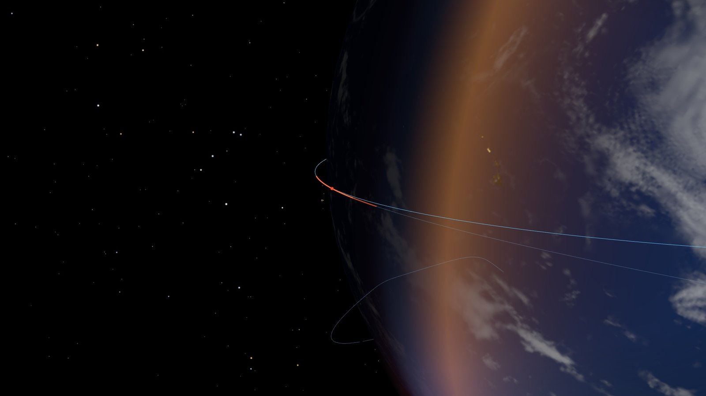
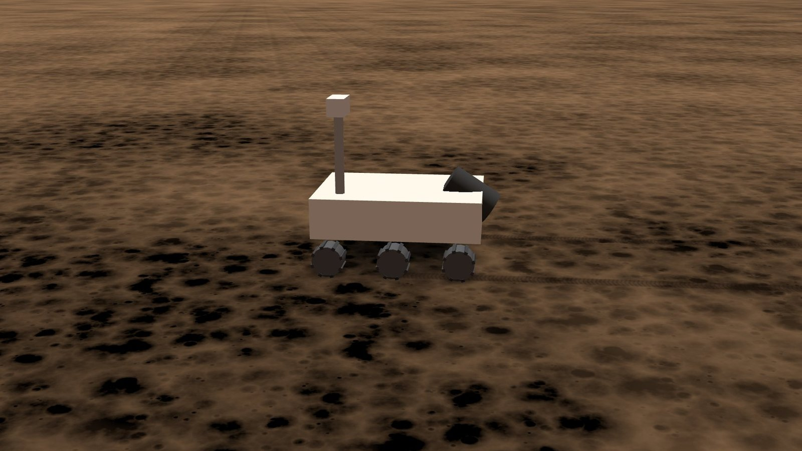
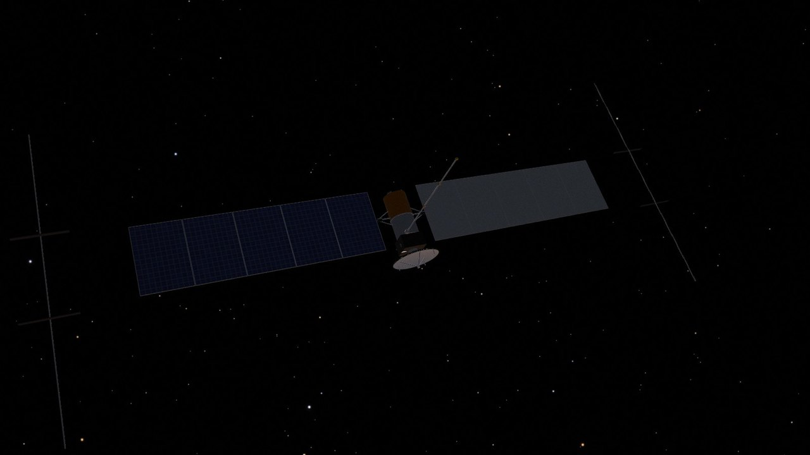
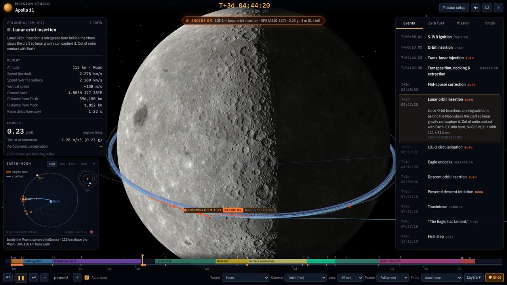

# Moon & Mars Mission Studio

**A 3D simulator of real Moon and Mars missions that runs in your browser.** Pick a mission and watch it fly, from the countdown on the pad to landing. On-screen numbers explain every moment: payload, rocket size, propellant, gravity, acceleration, orbits and gravity assists. It was built for storyboarding a solar-system film, so the cameras, lenses and shot capture work like a film tool.

[**▶ Open the simulator**](https://sanghyunpark.pages.dev/apps/mission-studio/) · [About the project](https://sanghyunpark.pages.dev/projects/mission-studio/) · [한국어 안내](README.ko.md)


## What you can do

- **Choose a mission or build your own.** There are 13 presets based on flown and planned missions. Before the flight starts you can change:
  - the launch vehicle
  - the launch date and site
  - the parking orbit
  - the flight times
  - the lunar orbit altitude
  - the landing site and surface stay
  - the crew
- **Watch the whole voyage.** The simulation includes:
  - liquid engines lighting on the pad before T−0 and the hold-down release
  - the ascent, with staging and fairing jettison
  - the parking orbit and the transfer burns
  - flybys and gravity assists
  - entry, parachutes and the sky crane
  - powered landings, rover drives, lunar ascent and rendezvous
  - the return home
- **Read the numbers as they change.**
  - Altitude and speeds (inertial, over the surface, vertical) and the g-load felt.
  - Thrust and acceleration, propellant left and the Δv budget for each stage.
  - The pull of each body (Earth, Sun, Moon, Jupiter …) and the radio delay.
  - A plain-language explanation for every phase.
- **See when the engines fire.**
  - Engine burns are drawn as thick orange ribbons and coasting as thin blue lines.
  - The same colours are used on the 3D paths, the Solar System map and the timeline.
- **Direct the camera.**
  - An auto-follow "director" mode, plus orbit, chase, look-at, ground and top-down cameras.
  - Lenses from 12 to 3200 mm and film aspect-ratio guides (2.39:1, 1.85:1 …).
  - Drag to orbit and scroll or pinch to zoom.
- **Build a storyboard.** The **Shot** button saves a frame with a slate (mission time, camera, lens, telemetry) to a shot list. You can view the list as a contact sheet or copy it as text.

| | |
|---|---|
|  |  |
|  |  |

## Missions

| Mission | Year | Launch vehicle | Profile | Status |
|---|---|---|---|---|
| Apollo 8 | 1968 | Saturn V | Crewed lunar orbit & return | Flown |
| Apollo 11 | 1969 | Saturn V | Crewed landing & return | Flown |
| Apollo 13 | 1970 | Saturn V | Free-return abort (flyby) | Flown |
| Artemis II | 2026 | SLS Block 1 | Crewed lunar flyby (free return) | Flown |
| Chang'e 5 | 2020 | Long March 5 | Robotic landing & sample return | Flown |
| Mariner 4 | 1965 | Atlas LV-3 Agena-D | Mars flyby | Flown |
| Mars 2020 Perseverance | 2020–21 | Atlas V 541 | Mars entry, sky crane landing, rover drives | Flown |
| Tianwen-1 / Zhurong | 2020–21 | Long March 5 | Mars orbiter + landing | Flown |
| Europa Clipper (MEGA) | 2024 | Falcon Heavy | Mars and Earth gravity assists | In flight |
| Mars Sample Return | 2031 | Long March 5 | Robotic landing & sample return | Planned / concept |
| Crewed Mars — Starship | 2033 | Starship | Crewed landing & return (conjunction class) | Concept |
| Crewed Mars orbit & return | 2033 | Starship | Crewed orbit & return | Concept |
| Inspiration Mars | 2018 | SLS Block 1 | Crewed Mars flyby & free return | Concept (not flown) |

## How it works

Each flight is calculated from physics, not keyframed. The planner solves the mission when you press **Fly this mission**, inside a Web Worker. The renderer then plays the result back.

- **Ephemerides.** Planet positions use JPL's approximate Keplerian elements (valid 1800–2050). The Moon uses a truncated Meeus/ELP2000 series. Body orientation uses the IAU WGCCRE rotation models. The frame is J2000 ecliptic.
- **Ascent.** Each stage is integrated numerically: a gravity turn followed by closed-loop insertion guidance. The vehicle data are real: thrust at sea level and in vacuum, Isp, dry mass and propellant. The atmosphere uses the US-1976 model, and drag is modelled for the stack.
- **Earth–Moon flights.** These are integrated with a Dormand–Prince 5(4) integrator in an Earth + Moon + Sun force field. Burns are finite and targeted with Newton iterations.
- **Interplanetary flights.** These use patched conics. Departures are Lambert solutions and flybys use B-plane targeting. The planet-centred hyperbola and the heliocentric arc join at the sphere of influence.
- **Landing.**
  - Mars entry has a parachute and a sky crane.
  - Capsules fly a lifting entry.
  - Powered descent uses ZEM/ZEV guidance.
- **Propellant.** It is tracked with the rocket equation, stage by stage, so the Δv budget always adds up.

### Accuracy

This is a storyboard and teaching tool, not mission-design software.

- Trajectories are solved again from the mission inputs, so event times are close to the flown missions but not identical. For example, Apollo 11's touchdown comes out at about 103 h 36 m after liftoff, against 102 h 45 m in reality.
- After Perseverance's first drive, which matches the real one on 4 March 2021, the rover's daily drives are illustrative.
- The concept missions follow published architectures and their stated assumptions.

## Run it locally

You need [Node.js](https://nodejs.org/) 18 or later and a browser with WebGL 2.

```bash
git clone https://github.com/sean-lab/mission-studio.git
cd mission-studio
node build.js                         # → dist/
python3 -m http.server -d dist 8000   # or: npx serve dist
# open http://localhost:8000
```

The page must be served over HTTP, because opening the file directly blocks the texture loads and the Web Worker. Every path in `dist/` is relative, so the folder works from any base path. Pushing a `v*` tag runs `.github/workflows/release.yml`, which attaches `mission-studio-<tag>.tar.gz` (the contents of `dist/`) to a GitHub Release.

Engine tests (Node, no browser):

```bash
node test/t_core.js      # ephemerides vs. Meeus examples, Kepler/Lambert round trips
node test/t_ascent.js    # ascent solutions for every launcher
node test/t_lunar.js     # Earth–Moon profiles
node test/t_mission.js   # complete missions
```

### Project layout

```
src/      flight engine (plain JavaScript; also runs in a Web Worker)
app/      renderer and UI (ES module), markup and styles
assets/   planet textures and the star catalogue
vendor/   three.js r160 (MIT)
test/     Node tests for the engine
media/    screenshots for this README
```

## Credits

- **three.js** r160 ([MIT](vendor/three.LICENSE)), included in `vendor/`.
- **Earth day, night and cloud maps:** [Solar System Scope](https://www.solarsystemscope.com/textures/) ([CC BY 4.0](https://creativecommons.org/licenses/by/4.0/)). They are taken from the three.js examples, which resized and merged them.
- **Moon map:** `moon_1024.jpg` from the [three.js examples](https://github.com/mrdoob/three.js/tree/dev/examples/textures/planets).
- **Mars, Venus, Jupiter and Saturn maps:** [NASA 3D Resources](https://github.com/nasa/NASA-3D-Resources), resized.
- **Stars:** `stars.6.json` from [d3-celestial](https://github.com/ofrohn/d3-celestial) by Olaf Frohn (BSD 3-Clause), based on XHIP (Anderson & Francis 2012, VizieR V/137D).
- **Fonts:** IBM Plex Sans Condensed and IBM Plex Mono ([SIL OFL 1.1](https://openfontlicense.org/)), via Google Fonts.
- **Mission and vehicle data:** NASA mission reports and press kits, NASA/JPL, CNSA releases, and published SpaceX and ISRO figures.

## License

The code is released under the [MIT License](LICENSE). The third-party assets listed above keep their own licenses.
